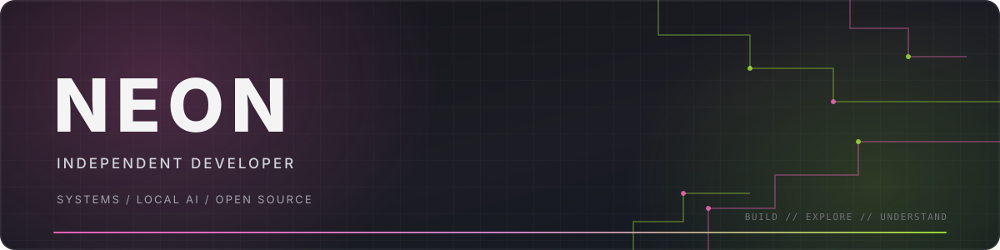

# Neon
 

  

  <strong>Building software. Exploring ideas. Understanding systems.</strong>

  
  

---

### Tech & Tools

#### Languages

<table align="center">
  <tr>
    <td align="center" width="150">
      
       Rust
    </td>
    <td align="center" width="150">
      
       Python
    </td>
    <td align="center" width="150">
      
       JavaScript
    </td>
    <td align="center" width="150">
      
       TypeScript
    </td>
  </tr>
  <tr>
    <td align="center" width="150">
      
       C
    </td>
    <td align="center" width="150">
      
       HTML5
    </td>
    <td align="center" width="150">
      
       CSS3
    </td>
    <td align="center" width="150">
      
       Bash
    </td>
  </tr>
</table>

#### Environment & Tools

<table align="center">
  <tr>
    <td align="center" width="150">
      
       Linux
    </td>
    <td align="center" width="150">
      
       Git
    </td>
    <td align="center" width="150">
      
       GitHub
    </td>
  </tr>
  <tr>
    <td align="center" width="150">
      
       VSCodium
    </td>
    <td align="center" width="150">
      
       OpenCode
    </td>
    <td align="center" width="150">
      
       Konsole
    </td>
  </tr>
</table>

---

### GitHub Statistics

  

  
  

---

### Selected Projects

<table>
  <tr>
    <td width="33%" valign="top">
      <h3>RAMforge</h3>
      A Rust inference runtime that orchestrates storage, system RAM and VRAM to run local models beyond available memory.
        
      <code>Rust</code> <code>AI</code> <code>Systems</code>
        
      <a href="https://github.com/NeonMC23/RAMforge">View repository ↗</a>
    </td>
    <td width="33%" valign="top">
      <h3>LiDAR-HD-Viewer</h3>
      A desktop point-cloud viewer with multi-tile LAS/LAZ loading, level of detail and terrain visualization.
        
      <code>LiDAR</code> <code>3D</code> <code>Desktop</code>
        
      <a href="https://github.com/NeonMC23/LiDAR-HD-Viewer">View repository ↗</a>
    </td>
    <td width="33%" valign="top">
      <h3>NeoSense</h3>
      A Linux command-line tool for notebook fan control through NBFC, inspired by Acer NitroSense.
        
      <code>Linux</code> <code>CLI</code> <code>Hardware</code>
        
      <a href="https://github.com/NeonMC23/NeoSense">View repository ↗</a>
    </td>
  </tr>
  <tr>
    <td width="33%" valign="top">
      <h3>0rbis-7B</h3>
      An offline-first knowledge interface designed for local access to information.
        
      <code>AI</code> <code>Offline-first</code> <code>Knowledge</code>
        
      <a href="https://github.com/NeonMC23/0rbis-7B">View repository ↗</a>
    </td>
    <td width="33%" valign="top">
      <h3>Flow</h3>
      A browser-based music player built with vanilla JavaScript, HTML and CSS, without a frontend framework.
        
      <code>JavaScript</code> <code>HTML</code> <code>CSS</code>
        
      <a href="https://github.com/NeonMC23/Flow">View repository ↗</a>
    </td>
    <td width="33%" valign="top">
      <h3>NeoDesk</h3>
      A customizable browser new-tab dashboard that brings shortcuts and useful information into one place.
        
      <code>JavaScript</code> <code>Web</code> <code>Dashboard</code>
        
      <a href="https://github.com/NeonMC23/NeoDesk">View repository ↗</a>
    </td>
  </tr>
</table>

### About

I'm a developer focused on systems programming, local AI infrastructure, and practical open-source software. I enjoy building tools that solve concrete problems, exploring low-level engineering, and designing systems with clear boundaries and long-term maintainability in mind.

My projects range from resource-efficient AI runtimes and hardware utilities to geospatial visualization and lightweight web applications.

#### Engineering Principles

- **Performance with purpose** — Optimize where it matters, without sacrificing correctness.
- **Clear architecture** — Keep responsibilities separated and interfaces explicit.
- **Resource awareness** — Treat memory, storage, and compute as constraints to engineer around.
- **Privacy by design** — Prefer local-first solutions and minimize unnecessary dependencies.
- **Open-source mindset** — Build software that others can inspect, understand, and improve.

---

  Build with purpose. Learn continuously.
   
  <a href="https://github.com/NeonMC23?tab=repositories">Explore my repositories ↗</a>

---
