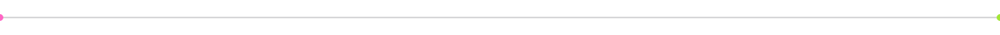

  

  <strong>Building software. Exploring ideas. Understanding systems.</strong>

  
  

  

### Tech & Tools

#### Languages

<table align="center">
  <tr>
    <td align="center" width="150">
      
       Rust
    </td>
    <td align="center" width="150">
      
       Python
    </td>
    <td align="center" width="150">
      
       JavaScript
    </td>
    <td align="center" width="150">
      
       TypeScript
    </td>
  </tr>
  <tr>
    <td align="center" width="150">
      
       C
    </td>
    <td align="center" width="150">
      
       HTML5
    </td>
    <td align="center" width="150">
      
       CSS3
    </td>
    <td align="center" width="150">
      
       Bash
    </td>
  </tr>
</table>

#### Environment & Tools

<table align="center">
  <tr>
    <td align="center" width="150">
      
       Linux
    </td>
    <td align="center" width="150">
      
       Git
    </td>
    <td align="center" width="150">
      
       GitHub
    </td>
  </tr>
  <tr>
    <td align="center" width="150">
      
       VSCodium
    </td>
    <td align="center" width="150">
      
       OpenCode
    </td>
    <td align="center" width="150">
      
       Konsole
    </td>
  </tr>
</table>

  

### GitHub Statistics

  

<table>
  <tr>
    <td width="50%" valign="top">
      
    </td>
    <td width="50%" valign="top">
      
       
      
       
      
    </td>
  </tr>
</table>

  

### Selected Projects

  A selection of projects focused on systems, local AI, hardware and software development.

<table>
  <tr>
    <td width="50%" valign="top">
      <h3>RAMforge</h3>
      

        A Rust-based local inference runtime designed to run models larger than available RAM or VRAM by orchestrating system memory, GPU memory and storage.
      

      

        
        
        
      

      
    </td>
    <td width="50%" valign="top">
      <h3>NeoSense</h3>
      

        A Linux fan-control CLI and supervisor built around NBFC, bringing a modern control interface and safety-oriented hardware management to Acer laptops.
      

      

        
        
        
      

      
    </td>
  </tr>
  <tr>
    <td width="50%" valign="top">
      <h3>LiDAR-HD-Viewer</h3>
      

        A desktop application for exploring large LAS/LAZ point clouds, featuring multi-tile loading, level-of-detail rendering and multiple visualization modes.
      

      

        
        
        
      

      
    </td>
    <td width="50%" valign="top">
      <h3>0rbis-7B</h3>
      

        An offline-first knowledge environment designed to explore large local datasets, including encyclopedias, maps, documents and local AI models.
      

      

        
        
        
      

      
    </td>
  </tr>
</table>

#### More Projects

<table>
  <tr>
    <td width="50%" valign="top">
      <strong>Flow</strong>
      
A lightweight browser-based music player with a dynamic music library, album organization and real-time filtering.

      

        
        
        
      

      
    </td>
    <td width="50%" valign="top">
      <strong>NeoDesk</strong>
      
A customizable browser new-tab dashboard bringing shortcuts, useful tools and productivity features together.

      

        
        
        
      

      
    </td>
  </tr>
</table>

  

### About

  <strong>Independent Developer</strong>

  I build software to understand systems, explore ideas and solve technical challenges.

  Interested in systems programming, local AI, hardware and open-source software, I enjoy turning ideas into practical projects and learning through experimentation.

  
  
  
  

  <strong>BUILD // EXPLORE // UNDERSTAND</strong>

  

  Build with purpose. Learn continuously.
   
  

